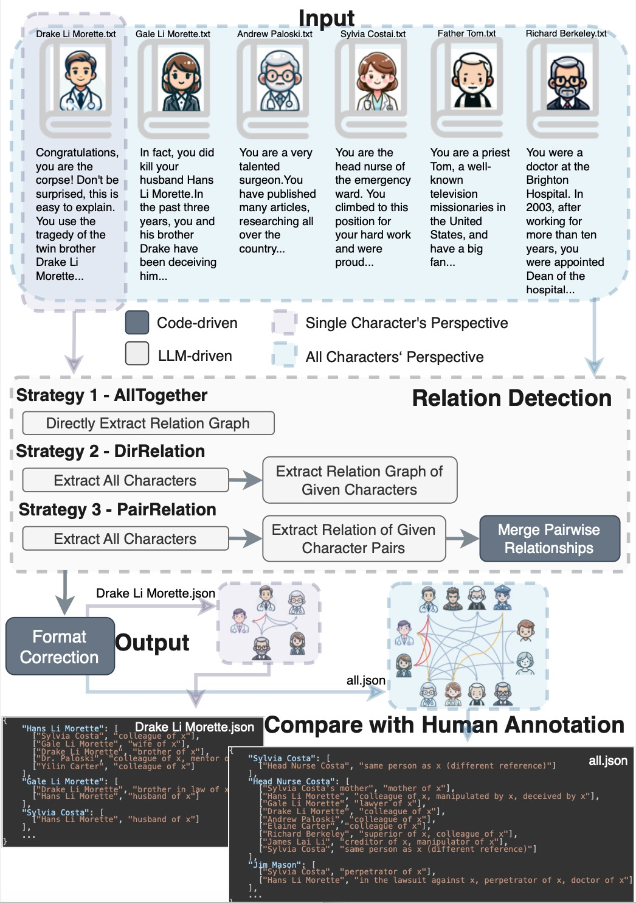

# Conan: Official Code for Understanding Complex Relationships in Detective Narratives

This repository contains the official code and benchmark resources for the paper **[Large Language Models Fall Short: Understanding Complex Relationships in Detective Narratives](https://aclanthology.org/2024.findings-acl.454/)**, published in **Findings of ACL 2024**.

Conan is a benchmark for narrative understanding, character relationship extraction, and relation graph analysis in detective narratives. The dataset focuses on complex social relationships, role-oriented perspectives, public and secret character relations, and long-context reasoning for large language models.

**Keywords:** Conan benchmark, detective narratives, narrative understanding, character relationship extraction, relation graph, social relation extraction, long-context reasoning, role-oriented annotation, LLM evaluation.

- Paper: [ACL Anthology](https://aclanthology.org/2024.findings-acl.454/)
- PDF: [2024.findings-acl.454.pdf](https://aclanthology.org/2024.findings-acl.454.pdf)


## Environment
Dependency packages are in `environment.yml`, you can update the prefix. You can then create a new environment from this file:

```{bash}
conda env create -f environment.yml
```

## Data
The preprocessed data included in `[data/]` is available in two languages, English and Chinese. The original data is in Chinese, with story names as folder names in `[data/chinese/data_final]`. Access to the original version requires purchase.

Each narrative features descriptions from various characters' perspectives, located in `[data/language/data_final/narrative_name/txt/character_name]`. The corresponding labels of relationships from a single character's perspective can be found in `[data/language/label/narrative_name/txt/character_name]`, and the relationships combining information from all characters are in `[data/language/label/narrative_name/txt/all]`.



## Follow-up Work

This project is part of a broader line of work on narrative understanding, social reasoning, character relationship extraction, and interactive LLM-based systems.

### PLAYER*: Enhancing LLM-based Multi-Agent Communication and Interaction in Murder Mystery Games

[PLAYER*](https://arxiv.org/abs/2404.17662) extends this research direction from detective narrative relationship understanding to multi-agent murder mystery games. It introduces **WellPlay**, a reasoning dataset for multi-agent conversational inference, and studies how LLM-based agents can communicate, ask questions, infer objectives, and reason about hidden social relationships in complex murder mystery game settings.

- Paper: [arXiv:2404.17662](https://arxiv.org/abs/2404.17662)
- PDF: [2404.17662.pdf](https://arxiv.org/pdf/2404.17662)
- Code: [alickzhu/PLAYER](https://github.com/alickzhu/PLAYER)
```bibtex
@misc{zhu2024player,
  title = {{PLAYER}*: Enhancing LLM-based Multi-Agent Communication and Interaction in Murder Mystery Games},
  author = {Zhu, Qinglin and Zhao, Runcong and Liang, Bin and Du, Jinhua and Gui, Lin and He, Yulan},
  year = {2024},
  eprint = {2404.17662},
  archivePrefix = {arXiv},
  primaryClass = {cs.CL},
  doi = {10.48550/arXiv.2404.17662},
  url = {https://arxiv.org/abs/2404.17662}
}
```

### SymbolicThought: Integrating Language Models and Symbolic Reasoning for Consistent and Interpretable Human Relationship Understanding

[SymbolicThought](https://arxiv.org/abs/2507.04189) is an **ACL 2026 Demo** paper that further develops this line of work into a human-in-the-loop system for relationship understanding. It combines LLM-based extraction with symbolic reasoning, editable character relationship graphs, logical constraints, and interactive conflict resolution. In particular, it introduces **logical annotations between character relationships**, enabling the system to capture relation-level dependencies, consistency constraints, and conflicts among interpersonal relations for more interpretable social relation annotation.

- Paper: [arXiv:2507.04189](https://arxiv.org/abs/2507.04189)
- PDF: [2507.04189.pdf](https://arxiv.org/pdf/2507.04189)
- Code: [BLPXSPG/SymbolicThought](https://github.com/BLPXSPG/SymbolicThought)
```bibtex
@misc{zhao2025symbolicthought,
  title = {SymbolicThought: Integrating Language Models and Symbolic Reasoning for Consistent and Interpretable Human Relationship Understanding},
  author = {Zhao, Runcong and Zhu, Qinglin and Xu, Hainiu and Liang, Bin and Gui, Lin and He, Yulan},
  year = {2025},
  eprint = {2507.04189},
  archivePrefix = {arXiv},
  primaryClass = {cs.CL},
  doi = {10.48550/arXiv.2507.04189},
  url = {https://arxiv.org/abs/2507.04189},
  note = {ACL 2026 Demo}
}
```

## Citation
If you use the Conan in your research, please cite our paper:

```bibtex
@inproceedings{zhao-2024-conan,
  title = {Large Language Models Fall Short: Understanding Complex Relationships in Detective Narratives},
  author = {Zhao, Runcong and Zhu, Qinglin and Xu, Hainiu and Li, Jiazheng and Zhou, Yuxiang and He, Yulan and Gui, Lin},
  booktitle = {Findings of the Association for Computational Linguistics: ACL 2024},
  pages = {7618--7638},
  year = {2024},
  address = {Bangkok, Thailand},
  publisher = {Association for Computational Linguistics},
  doi = {10.18653/v1/2024.findings-acl.454},
  url = {https://aclanthology.org/2024.findings-acl.454/}
}
```
